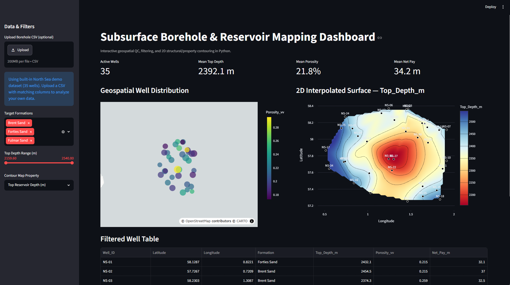

# Subsurface Borehole & Reservoir Mapping Dashboard
[Launch Live App](https://subsurface-map-dashboard.streamlit.app/)

An interactive Python web app built with Streamlit and Plotly for geospatial borehole QC, multi-formation filtering, and 2D interpolated structural/property contouring.

## Features
- **CSV Upload & Built-in Demo:** Works out of the box with a 35-well North Sea dataset or any user-uploaded borehole CSV.
- **Interactive Filtering:** Filter live by target formation and top reservoir depth range with instant KPI updates.
- **Geospatial & 2D Contour Mapping:** Displays interactive well locations alongside a cubic-interpolated 2D contour surface (`Top Depth`, `Porosity`, or `Net Pay`).
- **One-Click Export:** Download the filtered dataset directly as a clean CSV.

## Tech Stack
`Python` · `Streamlit` · `Plotly` · `SciPy` · `Pandas` · `NumPy`
